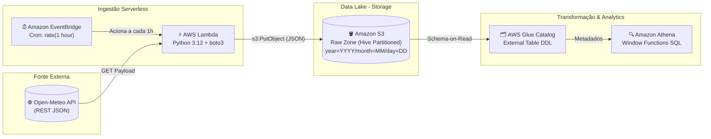
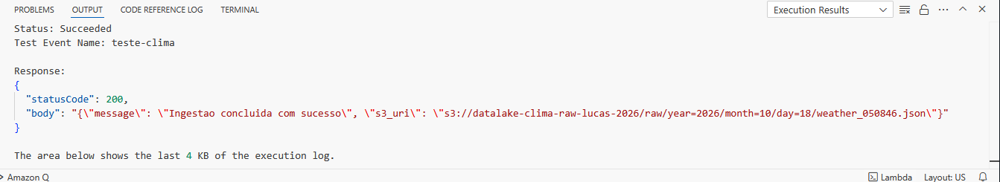
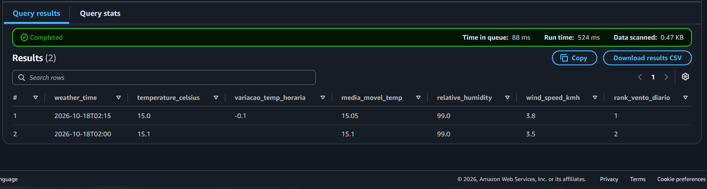

# ☁️ Cloud-Native Serverless ELT Pipeline (AWS)

Pipeline de Engenharia de Dados 100% Serverless construído na **AWS** para coleta automatizada, armazenamento em Data Lake particionado e análise histórica de dados meteorológicos da Região Metropolitana de São Paulo utilizando **Python** e **SQL Analítico**.

## 🏗️ Arquitetura do Pipeline

O fluxo segue o paradigma **ELT (Extract, Load, Transform)** moderno em nuvem, desacoplando o armazenamento bruto da camada de processamento analítico:



---

### Fluxo de Dados Passo a Passo:
1. **Orquestração (`Amazon EventBridge`):** Dispara um evento programado a cada hora (`rate(1 hour)`).
2. **Ingestão (`AWS Lambda`):** Executa um script Python que consome a API pública da Open-Meteo, enriquece o registro com carimbo de tempo de linhagem (`collected_at_utc`) e estrutura o caminho de destino.
3. **Armazenamento (`Amazon S3`):** Os dados brutos são persistidos na camada *Raw (Bronze)* seguindo o particionamento padrão **Hive** (`raw/year=YYYY/month=MM/day=DD/weather_HHMMSS.json`).
4. **Catálogo e Consulta (`Amazon Athena`):** Mapeia os arquivos do S3 em uma tabela externa via *Schema-on-Read* (`OpenX JsonSerDe`) e executa transformações analíticas com *Window Functions*.

## 🧠 Decisões Técnicas e Trade-offs

* **Por que Arquitetura Serverless (Lambda + S3 + Athena)?**
  Elimina o custo de manter servidores (EC2) ou bancos de dados relacionais (RDS) ligados 24/7. A cobrança ocorre estritamente por milissegundo de execução na ingestão e por volume de dados escaneados na consulta, mantendo o projeto 100% dentro do *AWS Free Tier*.

* **Por que Particionamento Hive (`year/month/day`) no S3?**
  Motores distribuídos como o Amazon Athena cobram por Terabyte escaneado. O particionamento físico permite o **Partition Pruning**: ao filtrar uma data no `WHERE`, o Athena lê apenas a subpasta correspondente em vez de varrer todo o Data Lake, reduzindo drasticamente o tempo de execução e o volume lido (apenas `0.47 KB` nas consultas de validação).

* **Por que `urllib.request` nativo em vez da biblioteca `requests`?**
  O uso da biblioteca padrão do Python dispensa a criação de pacotes `.zip` externos ou *Lambda Layers* para uma chamada HTTP GET simples, reduzindo o tamanho do artefato de deploy e acelerando o *Cold Start* da função.

* **Por que ELT com Schema-on-Read em vez de ETL tradicional?**
  Salvar o dado bruto em JSON diretamente no S3 garante que nenhuma informação original seja perdida caso a regra de negócio mude. A tipagem e os cálculos matemáticos ficam isolados na camada de leitura SQL no Athena.

## 📊 Demonstração Prática (Projeto em Execução)

### 1. Ingestão Serverless e Persistência no S3 (AWS Lambda)
Teste de execução da função Lambda confirmando retorno `HTTP 200` e gravação automática na estrutura particionada do S3:



### 2. Camada Analítica com Window Functions (Amazon Athena)
Execução da consulta analítica calculando variação térmica horária (`LAG`), média móvel de 3 leituras (`AVG OVER`) e ranking diário de velocidade de vento (`DENSE_RANK`), escaneando apenas **0.47 KB** no S3:



## 📂 Estrutura do Repositório

```text
├── assets/
│   ├── lambda_execution.png          # Evidência de execução da AWS Lambda
│   └── athena_analytics_result.png   # Evidência das queries analíticas no Athena
├── src/
│   └── lambda_function.py            # Código-fonte do ingestor serverless (Python)
├── sql/
│   ├── 01_ddl_raw_weather.sql        # Criação do banco, tabela externa e reparo de partições
│   └── 02_analytical_metrics.sql     # Transformações analíticas com Window Functions
├── .env.example                      # Template de variáveis de ambiente
├── .gitignore                        # Arquivos ignorados pelo versionamento Git
├── requirements.txt                  # Dependências para desenvolvimento local
└── README.md                         # Documentação técnica do projeto
```

## 🚀 Como Reproduzir o Projeto

### Pré-requisitos
* Conta na AWS (Nível Gratuito / Free Tier).
* Python 3.12+ (para testes locais).

---

### Passo a Passo
1. **Clone o repositório:**
   ```bash
   git clone https://github.com/LucMNS/aws-serverless-weather-elt.git
   cd serverless-weather-pipeline
   ```
2. **Configure as variáveis de ambiente:**
   Baseie-se no arquivo `.env.example` para definir o nome do seu bucket (`BUCKET_NAME`) e as coordenadas desejadas.

3. **Provisionamento na AWS:**
   * Crie um bucket privado no **Amazon S3**.
   * Crie uma **IAM Role** para a Lambda com as políticas `AWSLambdaBasicExecutionRole` e permissão de escrita (`s3:PutObject`) no bucket.
   * Crie a função no **AWS Lambda** (Python 3.12), cole o código de `src/lambda_function.py` e configure o gatilho no **Amazon EventBridge** com `rate(1 hour)`.

4. **Catálogo e Consultas no Amazon Athena:**
   * Configure o bucket de resultados de queries no Athena.
   * Execute o script `sql/01_ddl_raw_weather.sql` para registrar a tabela externa e carregar as partições (`MSCK REPAIR TABLE`).
   * Execute o script `sql/02_analytical_metrics.sql` para visualizar os indicadores analíticos.

---

<p align="center">
  Desenvolvido por <a href="https://github.com/LucMNS"><b>LucMNS</b></a>
</p>